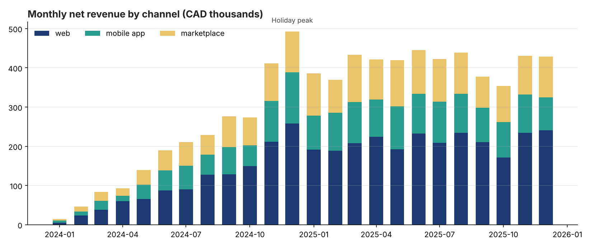
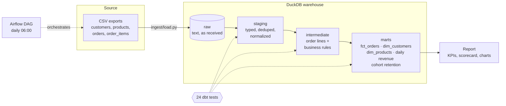
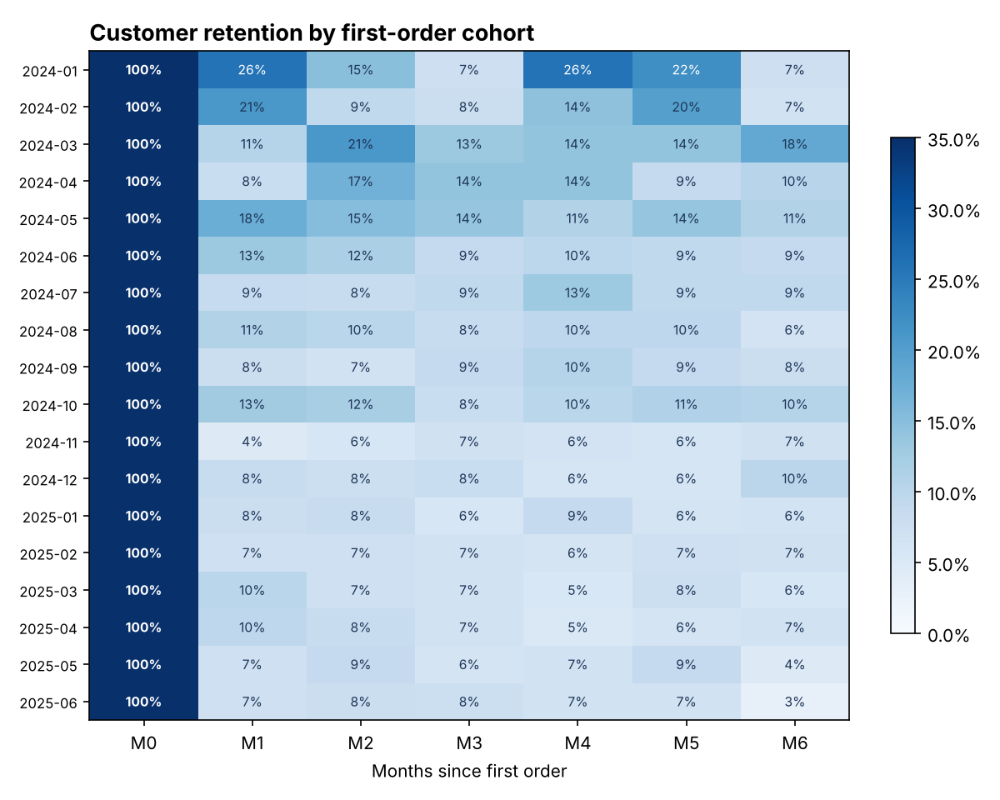

# 🛒 Retail Data Pipeline: messy exports → tested analytics warehouse


An end-to-end **ELT pipeline** for a fictional Canadian online retailer: it loads **59,000+ rows of deliberately messy exports**, cleans and models them with **dbt** in a **DuckDB** warehouse, enforces **24 data tests**, and publishes a report with KPIs, cohort retention, and a **data-quality scorecard**. It's orchestrated by an **Airflow DAG** and runs end to end in CI on every push.



---

## Data quality is measured, not assumed

The raw data contains real-world problems, injected on purpose and counted in a manifest. The pipeline has to find and handle every one, and the tests fail if it doesn't.

| Issue in raw data | Injected | Detected | How the pipeline handles it | |
|---|---|---|---|---|
| Duplicate order rows (re-sent export) | 291 | 291 | Removed (dedup on `order_id`) | ✅ |
| Emails with bad casing/whitespace | 596 | 596 | Normalized (lower + trim) | ✅ |
| Province codes with bad casing/whitespace | 460 | 460 | Normalized (upper + trim) | ✅ |
| Orders with no customer id | 449 | 449 | Kept, flagged as guest checkout | ✅ |
| Returns recorded as negative quantities | 1,459 | 1,459 | Moved to `return_amount` | ✅ |
| Lines for products missing from the catalogue | 148 | 148 | Kept, flagged, and raised as a dbt **warning** | ✅ |

**Revenue reconciles to the cent:** net revenue rebuilt straight from the raw text files equals the warehouse total. That's checked by both a dbt test and a pytest test.

## Architecture



| Layer | What happens |
|---|---|
| **raw** | Exports loaded exactly as received, all text, plus `_loaded_at` and `_source_file`, so you can always replay |
| **staging** | Types cast, `"$1,299.00"` parsed to numbers, duplicates removed, emails and provinces normalized |
| **intermediate** | Business rules: cancelled orders carry no revenue, returns reduce net revenue, orphan products are flagged, not dropped |
| **marts** | Star schema for analytics. `fct_orders` is **incremental** with a 3-day lookback for late-arriving data |

## Results

From the latest run (the pipeline finishes end to end in about 17 seconds):

- **Net revenue:** $7.38M (gross $7.72M, returns $334K) across **13,865 orders**
- **Average order value:** $532.40 · **Repeat-customer rate:** 36.5%
- **Customer segments:** 343 VIPs (top 5% by lifetime value) generate **$1.97M**



The full report is regenerated on every run: [`reports/pipeline_report.md`](reports/pipeline_report.md).

## Testing

- **24 dbt tests:** uniqueness, not-null, accepted values, relationships, plus custom tests for revenue reconciliation and impossible dates (orders before signup or in the future)
- **6 end-to-end pytest tests:** every injected issue detected, no duplicate orders reach the marts, revenue reconciles to raw, cancelled orders carry no revenue, cohort month 0 is 100%, and **re-running the incremental model is idempotent**
- **CI** runs the whole pipeline and all tests on every push and on a weekly schedule, and publishes the report to the run summary

## Quick start

```bash
pip install -r requirements.txt
python run_pipeline.py      # extract → load → dbt build → report
pytest -q                   # end-to-end tests
make docs                   # browse dbt lineage and model docs
```

## Design decisions

- **ELT, not ETL.** Raw data lands untouched and all cleaning lives in version-controlled, tested SQL, so any fix can be replayed over history.
- **Warn vs. fail.** Orphan products are a known upstream issue, so they raise a dbt *warning* that stays visible without blocking the daily load. Revenue reconciliation is a hard *failure*, because publishing wrong numbers is worse than publishing late.
- **Incremental with a lookback window.** Reprocessing the last 3 days picks up late lines and status changes without full rebuilds. A test proves re-runs are idempotent.
- **DuckDB.** A real analytical warehouse that runs in a single file, so the whole pipeline is reproducible on a laptop or in CI. The dbt models carry over to Snowflake or BigQuery with an adapter change.
- **Tests as a separate Airflow task.** `dbt_test` sits between `dbt_run` and `build_report`, so a failed data test stops bad numbers from being published.

## Project structure

```
ingest/       generate_raw.py (messy source data + manifest) · load.py (raw layer)
transform/    dbt project: staging → intermediate → marts, macros, custom tests
dags/         Airflow DAG (extract → load → dbt run → dbt test → report)
reports/      report builder: scorecard, KPIs, charts
tests/        end-to-end pytest suite
run_pipeline.py   local / CI orchestrator (same steps as the DAG)
```

---

Built by **Mohammed Bello Ibrahim** · [CalGrid AI](https://calgridai.com) · [LinkedIn](https://www.linkedin.com/in/mohammed-bello-ibrahim-7521b62a2/)
